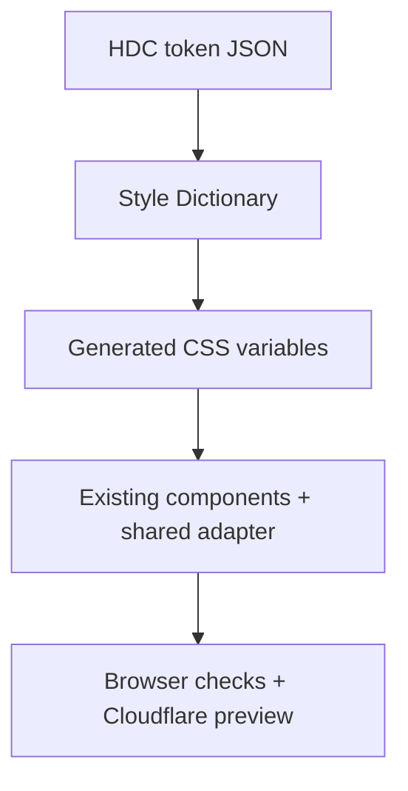

# HDC Engineered Tactility — implementation framework v2

## Canonical source and scope

- Verified production base: `4b28c545c5d31f9e674f10244307fb3b335cb789` (merged mobile readability PR #95).
- Working branch: `feat/hdc-design-system-20261019`.
- Root `index.html` is the canonical homepage.
- `previews/engineered-tactility-2026-10-07/index.html` is historical source, not another homepage. It stays unchanged. The canonical homepage still intentionally consumes its existing CSS, JavaScript and assets.
- `hdc-expanding-panels-lab.html` and `machine-dtf.html` are legacy routes with existing redirects; neither opts into v2.
- All 21 current public pages opt in with `data-hdc-system="v2"` and load the generated tokens followed by the shared component adapter. Copy, links, imagery, section order and interaction scripts are preserved.

## Art direction

Porsche's restraint and fluid scale, Carbon's alignment discipline and Geist's functional hierarchy inform an HDC-owned system. Their brand fonts, assets and component libraries are not imported.

Design variance: 7/10. Motion intensity: 3/10. Visual density: 4/10.

- Graphite `#0B1013` and charcoal `#171D21`: dark surfaces and primary ink.
- Paper `#F0EFED` and white `#FFFFFF`: light surfaces and inverse text.
- Teal `#036F86` and cyan `#47C1C7`: actions and focus on light/dark surfaces.
- Copper `#7D4E2C` and light copper `#D89A63`: restrained identity accents.
- Silver `#A9B3B7`: supporting text on dark surfaces.
- Existing HDC Display: editorial headings, with more comfortable leading and tracking.
- Existing HDC Sans: body, navigation, controls and form labels.
- Existing HDC Mono remains available for technical metadata; it is not the default action font.
- Large imagery carries visual identity. No extra decorative panels or perpetual animations are introduced.

## Token-to-code pipeline



| Responsibility | File |
| --- | --- |
| Authoritative values | `design/hdc.tokens.json` |
| Conversion and drift check | `scripts/build-design-tokens.mjs` |
| Generated browser output | `assets/css/hdc-tokens.css` |
| Component consumption, states, responsive exceptions | `assets/css/hdc-system.css` |
| Homepage access to existing HDC typefaces | `assets/css/hdc-typefaces.css`, `assets/fonts/` |
| Browser acceptance checks | `tests/design-system.spec.ts`, `playwright.config.ts` |

Style Dictionary 5.7.0 and Playwright 1.56.1 are pinned in the lockfile. Tokens use Style Dictionary's consistent `value`/`type` format. Fluid CSS expressions use string tokens intentionally. Do not mix legacy and DTCG token formats in the same dictionary.

The generated CSS is committed for direct static hosting. `npm run tokens:check` formats in memory and fails if output differs. It never rewrites the committed file. The build rejects broken references and warnings. Output has no timestamp, so equal inputs produce equal CSS. Wrangler's custom build command regenerates tokens before asset packaging, including direct CLI deployments; the Cloudflare preview build is the final integration check.

## Component contract

- Body: 16px minimum at the default browser font size, with relative units and 1.65 line height.
- Lead: 18–22px fluid range. Section and display scales use bounded `clamp()` expressions.
- Actions: 15px; form text: at least 16px; metadata: 13px.
- Native buttons, summaries and main action controls: at least 48px tall. Icon controls also have a 48px minimum width; arrow glyphs are 24px.
- Navigation uses the functional sans and sentence case. Logo geometry remains governed by the existing approved brand stylesheet.
- One fluid gutter scale and a 1440px maximum content frame connect both existing CSS families. Full-bleed images keep their edge-to-edge presentation.
- Existing mobile shrink/wrap fixes remain active. Changing tokens does not replace responsive layout rules.
- Focus is visible; reduced motion disables animation and transitions. Touch does not require hover.
- `hdc-system.css` is the bounded adapter between the two existing style families. Do not add generic global overrides to historical source stylesheets.

## Font provenance

The homepage's WOFF2 files are byte-for-byte extractions of the first two existing `@font-face` definitions in `assets/css/styles.css`. No new font provider or external request is introduced. Interior pages retain their existing embedded faces. The originals remain in place.

## Execution and release gates

1. Verify base SHA and classify index-like files.
2. Build tokens, check reproducibility, and connect the shared adapter.
3. Run the existing static validator and the browser matrix.
4. Inspect representative mobile and desktop screenshots.
5. Push the isolated branch; verify GitHub checks and its Cloudflare preview.
6. Request visual validation of that concrete preview before production promotion.

Chromium covers all 21 public pages at 320, 390, 430, 768, 900 and 1440px. WebKit covers 390 and 430px. Representative pages also check 200% text resizing; headers grow, words reflow and image-view controls wrap as needed. Interaction checks cover mobile navigation, catalogue search, product dialogs, finishing tabs, keyboard focus and form sizing. These are browser-rendered checks, not physical iPhone tests.

```sh
npm ci --ignore-scripts --no-audit --no-fund
npm run tokens:build
npm run tokens:check
python scripts/validate_site.py
npx playwright install --with-deps chromium webkit
npm run test:ui
npm run deploy -- --dry-run
```

Build tools, token source, test source and test output are excluded from uploaded static assets. The site remains a static asset Worker with no new runtime framework.

Reverting the feature commit restores the prior presentation through the existing review workflow. No source files are removed by this implementation.

## References

- https://styledictionary.com/reference/hooks/formats/
- https://designsystem.porsche.com/v4/stylesheets/css-variables/introduction/
- https://playwright.dev/docs/emulation
- https://developers.cloudflare.com/workers/wrangler/custom-builds/
